<div class="title-page">

# Identifying IPC Sections from Indian Case Facts, and the Move to the Bharatiya Nyaya Sanhita

### A comparison of lexical and transformer models on the ILSI dataset, with an IPC → BNS transition analysis

**Submitted by:** [Your name] · [Roll / registration number]<br>
**Course:** [Course name and code] · **Instructor:** [Instructor name]<br>
**Institution:** [Institution] · **Date:** [Submission date]

</div>

<div class="page-break"></div>

## Contents

1. Abstract
2. Introduction and problem statement
3. Dataset and exploratory analysis
4. Methods
5. Results
6. Analysis
7. IPC → BNS transition
8. Demo application
9. Limitations and ethics
10. Conclusion and future work
11. References
- Appendix A: Hyperparameters and compute
- Appendix B: Label set with BNS mapping
- Appendix C: BNS provisions with no IPC equivalent
- Appendix D: Reproducibility and file index

*Unless stated otherwise, every number is measured on the ILSI **test** set; every hyperparameter, threshold strategy and threshold was chosen on the **dev** set only.*

## 1. Abstract

We predict which Indian Penal Code (IPC) sections apply to an Indian criminal judgment, a multi-label classification task over 100 sections, using the ILSI dataset (about 66,000 judgments). We compare a statute-keyword baseline, TF-IDF with logistic regression, and two fine-tuned BERT models (general-domain bert-base-uncased and the legal-domain InLegalBERT).

**TF-IDF with logistic regression is the best model** (micro-F1 0.691, macro-F1 0.585). It beats the best BERT model, InLegalBERT (0.520 / 0.445), by 17 micro-F1 points (paired bootstrap, p < 0.001). A diagnostic that only extracts "section N" citations from the text scores 0.701 micro-F1 without learning anything: much of ILSI's label signal is section numbers the judgments already cite, which whole-document lexical models exploit and 512-token BERT only partly sees. On the 19% of test judgments that cite no gold section, all models are weak (0.31–0.35) but clearly beat the citation diagnostic (0.07), so they do infer offences from facts.

We also map the 100 labels to the Bharatiya Nyaya Sanhita (BNS), which replaced the IPC on 1 July 2024: 84 map one-to-one and four unverifiable mappings are withheld. Renumbering, new offences and citation-dependent models mean that relabelling alone will not keep such a system valid. A themed web demo shows predictions together with their BNS counterparts.

## 2. Introduction and problem statement

Legal statute identification asks: given the facts or text of a case, which provisions of law apply? For Indian criminal law this has meant sections of the IPC, for example §302 (murder) with §34 (common intention). Automating it could help legal research, case triage and legal aid. It is also a hard multi-label problem:
- documents carry about four sections each;
- sections co-occur strongly (§147/§148/§149 for rioting; §323/§506 for hurt and intimidation);
- frequency is very skewed;
- neighbouring sections differ in fine legal details (weapon used, severity of injury, intention).

**Task.** Given the text of a judgment, output the set of applicable IPC sections from a fixed list of 100.

**Questions.**
1. How do lexical baselines compare with fine-tuned BERT models, and does legal-domain pre-training help?
2. What do the models actually rely on?
3. What would it take to keep such a model useful after the switch from the IPC to the BNS?

**Metrics.**
- **micro-F1**, dominated by frequent sections;
- **macro-F1**, every section weighted equally;
- micro precision and recall, samples-F1, and mean per-label F1 in head, mid and tail frequency buckets.

## 3. Dataset and exploratory analysis

**ILSI** (Indian Legal Statute Identification; Paul, Goyal & Ghosh, AAAI 2022; Zenodo record 6053791) contains Indian court judgments, each labelled with the IPC sections it is linked to, plus the text of the 100 sections. We used the official splits and verified the MD5 checksums of the downloaded files.

**Table 1. Dataset statistics.**

| | Train | Dev | Test |
|---|---|---|---|
| Documents | 42,835 | 10,200 | 13,039 |
| Labels per document (mean) | 3.70 | 3.91 | 3.90 |
| Words per document (median / 95th percentile) | 458 / 4,128 | 579 / 4,486 | 567 / 4,271 |
| Documents longer than ~400 words (≈ BERT's 512 tokens) | 54% | 60% | 59% |

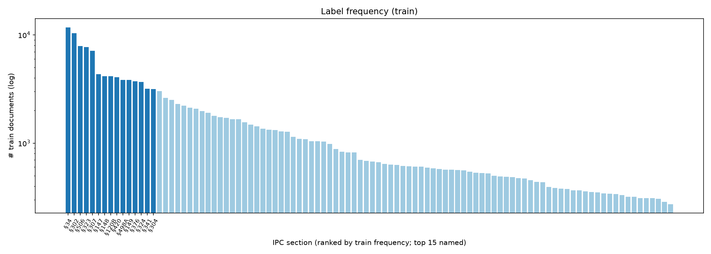

**Imbalance.** §34 occurs in 11,751 training documents, §450 in only 272 (43×). We split labels into tertiles by training frequency:
- **head:** 34 labels with 1,329–11,751 documents each, carrying 75% of all label occurrences;
- **mid:** 33 labels, 544–1,322 documents;
- **tail:** 33 labels, 272–533 documents, 8% of occurrences.

These buckets are used throughout the analysis.

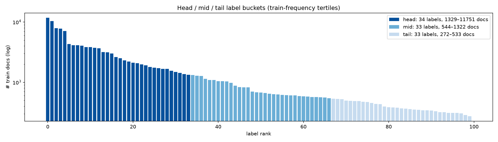

**Length.** More than half of all documents exceed the ~400 words that fit into BERT's 512-token input, so truncation matters (Figure 3).

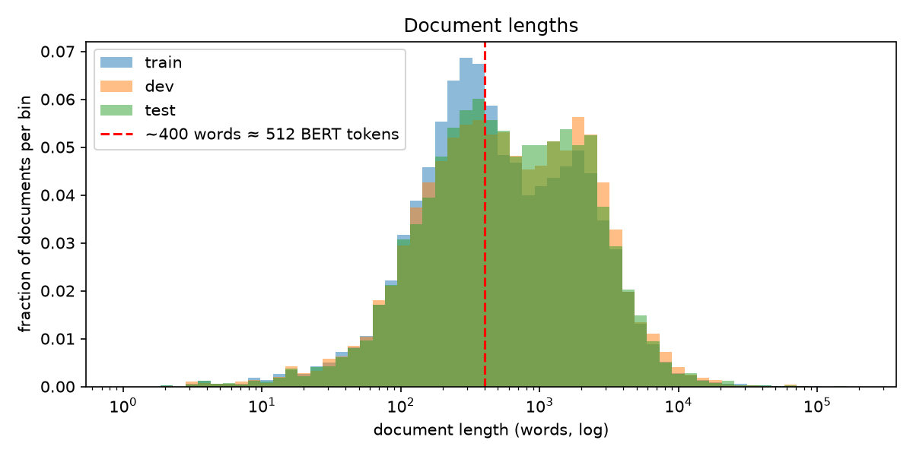

**Co-occurrence.** The strongest pairs are §147 & §148 (Jaccard 0.71), §148 & §149, and §302 & §34 (3,650 training documents).

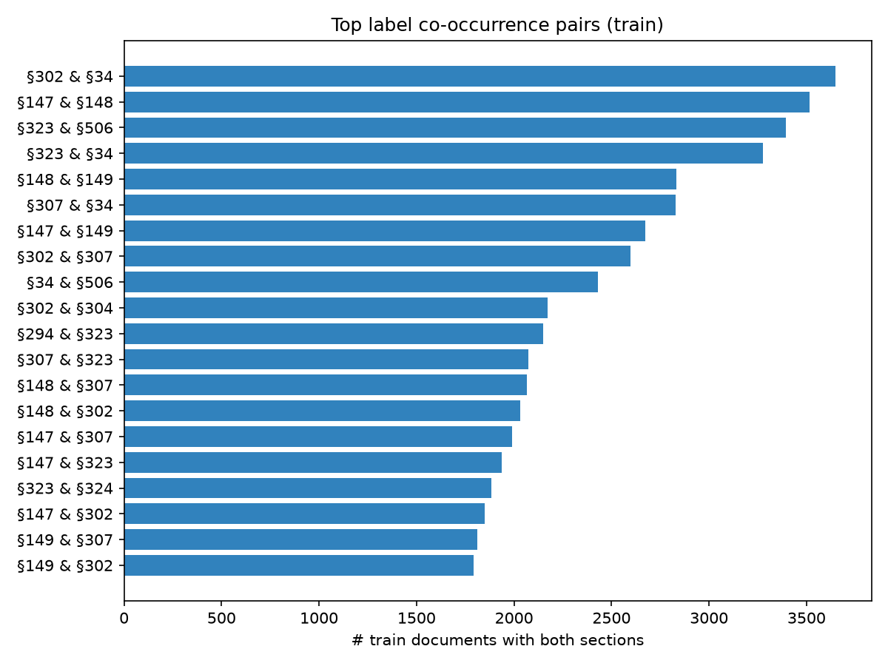

**Data-quality findings.** These matter for how the results should be read:
1. **Citations are not masked.** A list-aware citation parser finds a gold section cited verbatim ("Section 302 I.P.C.", "u/s 147, 148, 149") in **81%** of test documents: within the first ~400 words in 65%, only later in 16%, never in 19%.
2. **Non-offence and repealed sections are labels.** §2–§5 describe where the Code applies; §13 was repealed in 1950 and §161/§164 in 1988.
3. **Likely mis-linked citations.** In at least one test judgment, the gold labels §156, §173 and §200 correspond to *Code of Criminal Procedure* sections cited in the text ("Section 156(3) Cr.P.C."). Some labels may therefore come from other Acts' citations. This was observed in examples, not measured at scale.
4. **Near-empty documents.** 0.6% of documents have fewer than 10 words (for example only the judge's name).

## 4. Methods

Every model writes the same outputs (dev and test probabilities in one fixed label order, tuned thresholds, metrics), and all of them are scored by a single unit-tested evaluation module, so the results are directly comparable.

### 4.1 Baselines (laptop, Apple M1, 8 GB)

- **Keyword.** TF-IDF over the 100 statute texts (stop words and numbers removed). Each section keeps its top-*k* distinctive terms (*k* = 5, chosen on dev from {5, 10, 15, 25}). A document's score for a section is the weighted share of those terms it contains. No training documents are used.
- **TF-IDF + logistic regression.** Word 1–2-gram TF-IDF (100,000 features, sublinear term frequency, min_df 3, max_df 0.9) with one-vs-rest logistic regression (liblinear, class-balanced weights). The regularisation strength was chosen on dev: C = 1 (dev micro-F1 0.685) over C = 0.5 (0.661). The planned C ∈ {4, 10} and a linear-SVM variant were dropped because each C value needed about 40 minutes on the laptop.
- **Citation diagnostic.** Predicts §N whenever the text cites "section N" or "N IPC". It is not a model; it measures how much of the task can be solved by reading citations.

### 4.2 BERT models (Google Colab, NVIDIA A100)

- **Encoders.** `bert-base-uncased` and `law-ai/InLegalBERT` (LegalBERT further pre-trained on Indian court judgments; Paul et al., 2023). Each gets a 100-way sigmoid output layer.
- **Training.** 4 epochs, learning rate 2·10⁻⁵ with 10% warm-up and linear decay, batch 16 × gradient accumulation 2, weight decay 0.01, mixed precision, seed 42. The epoch with the best dev micro-F1 (at threshold 0.5) is kept. Each run took about 13 minutes.
- **Truncation.** *head* keeps the first 510 tokens. *head+tail* keeps the first 128 and the last 382, because judgments often end with the operative order.
- **Class imbalance.** Binary cross-entropy with a per-label positive weight = negatives / positives, clipped to [1, 30] (67 of the 100 labels hit the cap).
- **Validation before GPU use.** The training notebook was run end-to-end on the laptop with a tiny BERT model first. This found and fixed a crash in head+tail tokenisation.

### 4.3 Thresholding

Three strategies are evaluated, all tuned on dev:
- a fixed threshold of 0.5;
- one global threshold (0.05–0.95, step 0.01) maximising micro-F1;
- per-label thresholds maximising each label's F1, falling back to the global threshold for labels with fewer than 5 dev positives.

A document with no predicted label receives its single most likely label. Each model is reported at the strategy with the highest *dev* micro-F1, which was per-label for every learned model.

## 5. Results

**Table 2. Main results** (test set; each model at its dev-selected threshold strategy; the citation diagnostic is shown for reference).

| Model | Thresholds | Micro-F1 | Macro-F1 | Micro-P | Micro-R | Samples-F1 | Head F1 | Mid F1 | Tail F1 |
|---|---|---|---|---|---|---|---|---|---|
| Keyword (statute terms) | global | 0.176 | 0.107 | 0.162 | 0.191 | 0.131 | 0.176 | 0.083 | 0.061 |
| *Citation diagnostic* | — | *0.701* | *0.627* | *0.703* | *0.699* | *0.640* | *0.759* | *0.621* | *0.497* |
| **TF-IDF + LR** | per-label | **0.691** | **0.585** | 0.707 | 0.675 | **0.654** | 0.708 | 0.582 | 0.463 |
| BERT-base, head | per-label | 0.497 | 0.417 | 0.429 | 0.590 | 0.482 | 0.546 | 0.409 | 0.293 |
| InLegalBERT, head | per-label | 0.520 | 0.445 | 0.466 | 0.589 | 0.500 | 0.557 | 0.438 | 0.336 |
| InLegalBERT, head+tail | per-label | 0.511 | 0.436 | 0.458 | 0.578 | 0.495 | 0.550 | 0.424 | 0.329 |

All threshold strategies for every model are in `tables/results_all_strategies.csv`.

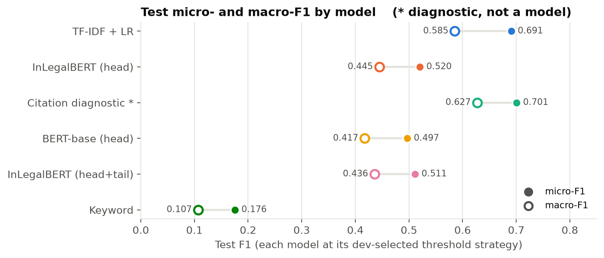

**Thresholds matter**, especially for BERT (Figure 6). The class weighting pushes BERT's probabilities up, so at 0.5 InLegalBERT reaches only 0.394 micro-F1 (precision 0.26). A tuned global threshold (0.77) gives 0.504 and per-label thresholds give 0.520. For TF-IDF the steps are 0.647 → 0.682 → 0.691.

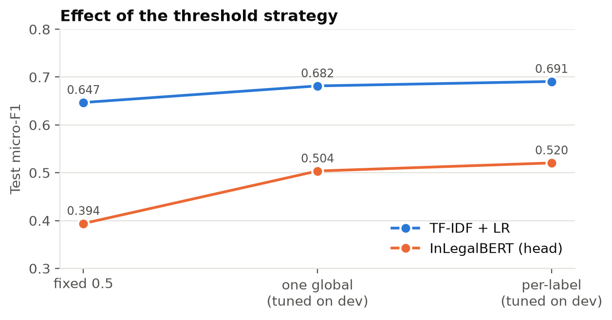

**Legal pre-training helps:** InLegalBERT beats bert-base-uncased by +2.4 micro-F1 and +2.7 macro-F1, with the largest gain on tail labels (+0.04). **Head+tail truncation did not help** (−0.9 micro-F1). Training was stable, and two of the three runs were still improving slightly at epoch 4 (Figure 7).

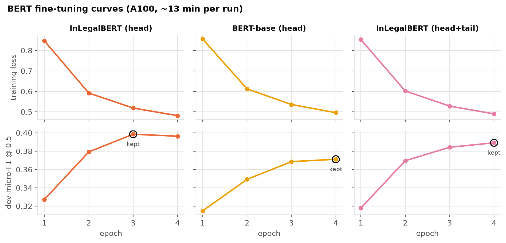

## 6. Analysis

### 6.1 Label frequency

The ranking of models is identical in every frequency bucket, and the learned models lose 0.22–0.26 F1 from head to tail labels (Figure 8, Table 3). BERT's gap to TF-IDF is roughly constant (−0.15 head, −0.14 mid, −0.13 tail), so BERT is not specifically better on rare labels. Per-label F1 correlates with log training frequency (Pearson r = 0.63 for TF-IDF, 0.52 for InLegalBERT, Figure 9). For both models the hardest labels are the non-offence sections §2, §3 and §4.

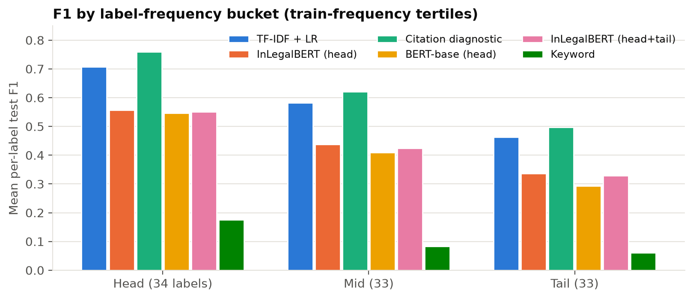

**Table 3. Mean per-label F1 by bucket.**

<!-- include-md: tables/bucket_f1.md -->

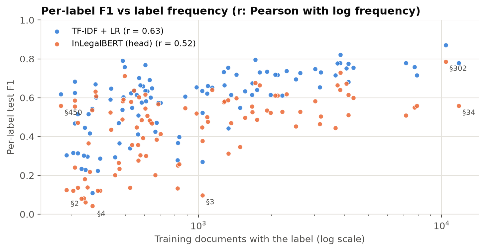

InLegalBERT matches or beats TF-IDF on only **1 of 100 labels** (§337, +0.007). Its largest losses (−0.21 to −0.36 F1) are §437, §465, §324, §307, §326 and §34: sections where the cited number is strong evidence and neighbouring sections read alike in prose. Full per-label scores are in `tables/per_label_f1.csv`.

### 6.2 Confusions between related sections

Errors concentrate in legally adjacent, often co-charged families, and InLegalBERT makes them 3–4× more often than TF-IDF (Figure 10):
- §34 is falsely added when §302, §307 or §149 is the true section (41% of §149 documents for BERT, 13% for TF-IDF);
- BERT mixes up the murder ladder §302/§304/§307;
- BERT mixes up the hurt ladder §323/§324/§325 (§324 is predicted in 15% of §323 documents, against 2% for TF-IDF).

Rioting (§147/§148/§149) and cheating vs criminal breach of trust (§420/§406) are confused less often (BERT 8–17%).

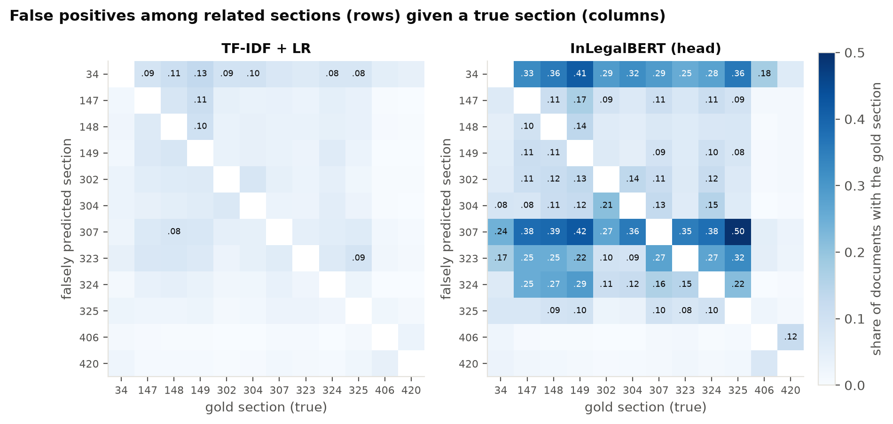

### 6.3 Why BERT trails: where the citations are

Splitting the test set by where a gold section is first cited explains most of the gap (Figure 11, Table 4):
1. **Truncation.** Late citations are invisible to BERT, and its micro-F1 drops from 0.59 to 0.43, while TF-IDF reads the whole document (0.76 → 0.69).
2. **Citation copying.** Even when the citation is inside its window, BERT does not reliably "copy" it (0.59 vs 0.78 for the regex).
3. **Facts only.** Without any citation, every model is weak, but both learned models clearly beat the regex (0.35 and 0.31 vs 0.07). This subset is closest to the intended task of inferring statutes from facts.

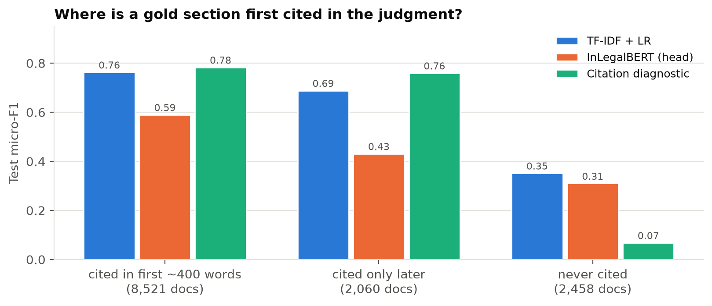

**Table 4. Micro-F1 by citation position.**

<!-- include-md: tables/citation_position.md -->

### 6.4 Error cases

370 test documents have document-level F1 ≥ 0.75 for TF-IDF and ≤ 0.25 for BERT; only 32 show the reverse. Eight of each were sampled at random (seed 42) and read in full; per-case comments are in the analysis notebook (`notebooks/02_analysis.ipynb`).
- **BERT fails, TF-IDF succeeds.** Five of eight are long judgments whose relevant citations sit beyond the 510-token window, or whose opening is procedural (a service-law writ, a correction application). In the rest, BERT predicts a semantically related cluster instead of the cited sections, e.g. §229A (bail-jumping) for a bail order that cites §§363/366/376/506 in its first 40 words.
- **TF-IDF fails, BERT succeeds.** All eight are short (131–432 words) and seven contain no citation. BERT infers the offence from the narrative: §302 from "sentenced to suffer imprisonment for life", the rioting trio from "five appellants", and bail-jumping from a bail-application context.

### 6.5 Statistical significance

**Table 5. Paired bootstrap** over test documents (1,000 resamples, seed 42; 95% confidence intervals).

<!-- include-md: tables/bootstrap.md -->

The difference is large and significant: no resample favoured BERT. This captures sampling variation in the test set, not training variance, because each BERT configuration was trained once.

## 7. IPC → BNS transition

*The full discussion is in `bns_discussion.md`; the mapping is in `tables/ipc_to_bns_mapping.csv`.*

**Building the mapping.** An official MHA/BPR&D correspondence table could not be accessed. Each of the 100 labels was checked row by row against a correspondence table compiled by the Director of CAPT Bhopal (a secondary source, cited in every row).
- 96 rows are confirmed by the source (or, for the three repealed sections, by ILSI's own statute text).
- For the remaining 4 (IPC 143, 427, 294(b), 376(2)) no BNS section could be verified, so their mapping is **withheld** rather than guessed.

**Coverage** (Figure 12, Table 6):
- 84 labels map one-to-one, carrying 86.8% of test label occurrences.
- 8 changed in scope (e.g. grievous hurt's 20-day threshold became 15 days); §506 splits into BNS 351(2) and 351(3); 3 were repealed long before the BNS.
- Because documents carry about four labels, only **63.4%** of test documents map cleanly in full.
- One-to-one relabelling leaves F1 unchanged by construction (TF-IDF 0.701, InLegalBERT 0.525 on the clean labels). It renames outputs and fixes nothing else.

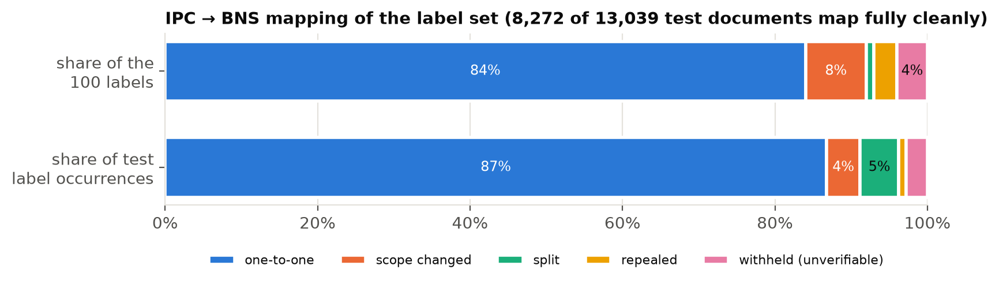

**Table 6. Mapping coverage.**

<!-- include-md: tables/bns_coverage.md -->

**What breaks.**
- **New offences have no training data:** organised crime (BNS 111), terrorist act (113), snatching (304), mob lynching (103(2)), false promise of marriage (69) and others (Appendix C).
- **The models read citations, and the numbers now mean different things.** For 95 of 100 labels, the TF-IDF model's five strongest features include the section's own number. Under the BNS: BNS 302 punishes hurting religious feelings, BNS 304 is snatching, BNS 307 is a theft offence. A model trained on IPC judgments will misfire on BNS-era text.
- **Both codes run in parallel.** Offences committed before 1 July 2024 continue under the IPC, so a deployed system must handle both codes for years. Meanwhile BNS-era reported judgments will remain scarce.

**Update strategies.**
1. **Deterministic relabelling,** applied on inputs with section numbers masked.
2. **Fine-tuning on BNS judgments** as they accumulate, with a dual IPC/BNS label space.
3. **Retrieval against statute text,** which needs only the statute's text for a new offence. As a calibration, the fine-tuned InLegalBERT encoder matching case facts to the 100 IPC statute texts reaches recall@5 = 0.29, against 0.05 for random ranking and 0.63 for the supervised classifier (Figure 13). The same experiment against BNS texts is implemented but was not run, because no reliable machine-readable BNS text was available.

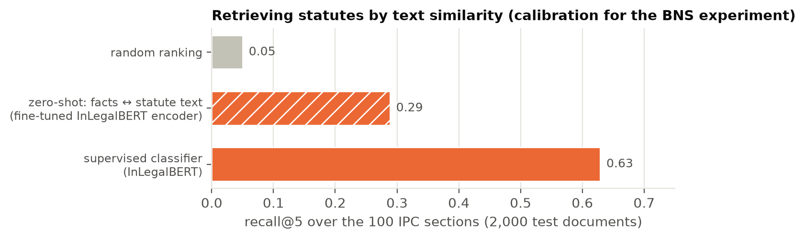

## 8. Demo application

A local web application, *Statute Finder*, demonstrates the models (FastAPI back end; hand-built HTML/CSS/JS front end with a law-library theme in dark and light variants).
- **Input:** paste case facts, or load one of three "exhibits" drawn from the test set.
- **Model choice:** fine-tuned InLegalBERT (default) or TF-IDF + LR, each shown with its test scores.
- **Output:** the ten most likely sections, each with its score bar and its own dev-tuned threshold, an "Applies" stamp when the threshold is cleared, and its BNS counterpart marked *verified*, *split*, *scope changed*, *withheld* or *repealed*.
- **Warnings:** sections already cited in the input are flagged, because the models lean on them. A "not legal advice" disclaimer is shown at the top and bottom of the page.

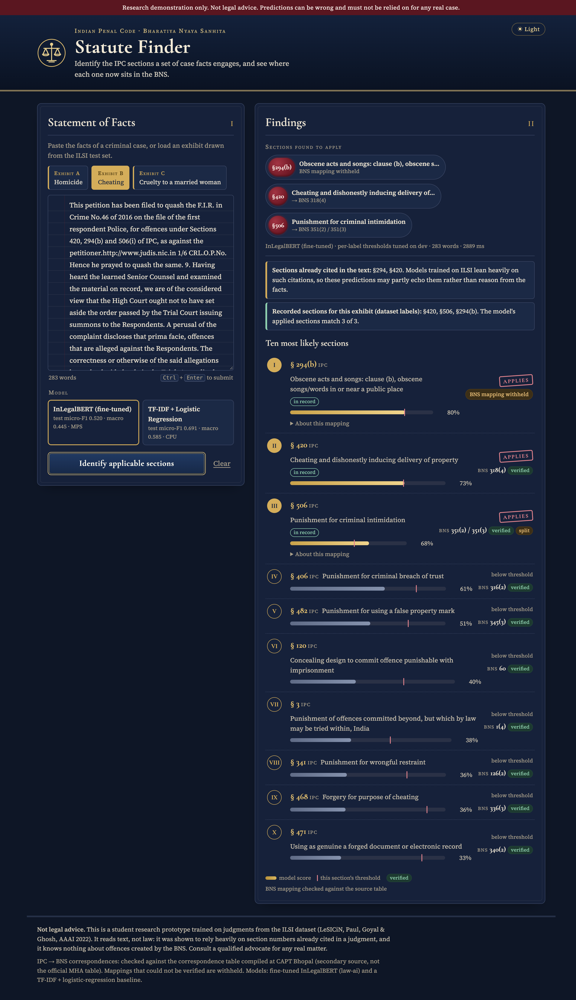

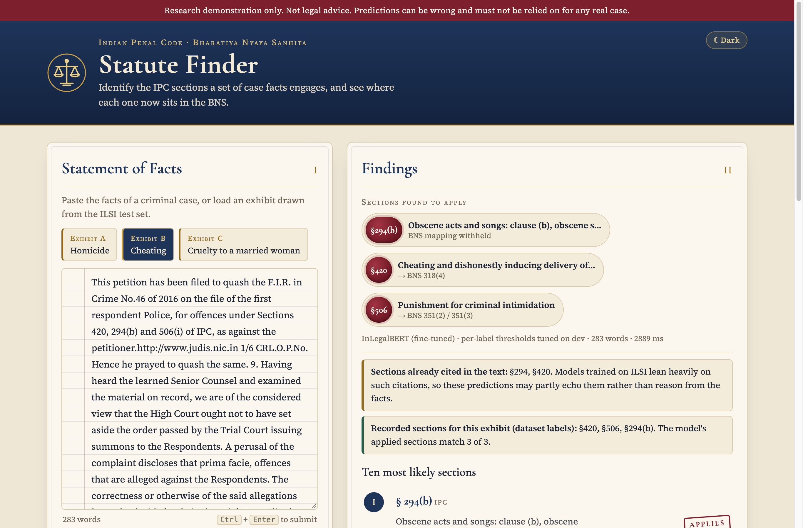

## 9. Limitations and ethics

**Limitations**
- **Benchmark leakage.** ILSI labels can largely be recovered from citations in the text, so headline scores overstate how well any model infers law from facts. The "never cited" subset (19% of test) is the more honest measure.
- **Label noise.** Non-offence sections, repealed sections and apparently mis-linked CrPC citations appear as labels, so some "errors" are label errors.
- **Reduced search.** One training seed per BERT configuration, a reduced regularisation grid, no SVM or character n-gram model, and 512-token truncation. Small differences such as head vs head+tail (−0.9 points) are within what seed variance could explain; this was not measured.
- **Possible pre-training overlap (unverified).** InLegalBERT was pre-trained on Indian Supreme Court and High Court judgments from 1950–2019, which may include ILSI test judgments.
- **Mapping source.** The BNS mapping rests on a secondary source; "verified" means checked against that table, not against an official government publication.

**Ethics**
- **Not legal advice.** The demo says so prominently, shows the mapping status, and warns when predictions may only echo citations.
- **Automation bias.** Statute suggestions can anchor investigators, lawyers or judges. A model trained on past charging and judicial practice reproduces its patterns, including any over-charging or bias across communities. It should support human review, never replace it.
- **Privacy.** Judgments are public but name parties, victims and witnesses. The data should be used for research only and not re-published in identifying form.
- **The law has changed.** After 1 July 2024, an IPC-only model is wrong for new offences by construction (Section 7).

## 10. Conclusion and future work

On ILSI, a well-tuned TF-IDF + logistic regression model beats fine-tuned BERT models by a large, significant margin. The analysis shows why: most judgments cite their own answer, whole-document lexical models read those citations, and 512-token BERT models see only some of them and do not reliably copy the ones they see. Where no citation exists, the problem is genuinely hard for all models. Legal-domain pre-training (InLegalBERT) helps modestly, especially for rare sections. The move to the BNS makes citation-based models fragile, because section numbers change meaning and new offences have no training data.

**Future work**
1. **Mask section numbers** and other Acts' citations in training and test text, so models are evaluated on facts → offence. This is the most important follow-up.
2. **Longer context:** hierarchical or long-document legal encoders, or chunk-and-aggregate BERT, to lift the 512-token limit.
3. **Robustness:** multiple seeds with confidence intervals over training runs; the full regularisation grid and SVM baselines.
4. **Label cleaning:** remove non-offence and repealed sections, and filter citations from other Acts.
5. **Statute-aware methods:** retrieval and graph methods that use statute text (as LeSICiN does), and the BNS zero-shot experiment once BNS texts are available.
6. **A dual IPC/BNS model,** fine-tuned on BNS-era judgments as they appear.

## 11. References

1. S. Paul, P. Goyal, S. Ghosh. *LeSICiN: A Heterogeneous Graph-based Approach for Automatic Legal Statute Identification from Indian Legal Documents.* Proceedings of AAAI 2022. Dataset: Zenodo, doi:10.5281/zenodo.6053791.
2. S. Paul, A. Mandal, P. Goyal, S. Ghosh. *Pre-trained Language Models for the Legal Domain: A Case Study on Indian Law.* Proceedings of ICAIL 2023; arXiv:2209.06049. Model: huggingface.co/law-ai/InLegalBERT.
3. J. Devlin, M.-W. Chang, K. Lee, K. Toutanova. *BERT: Pre-training of Deep Bidirectional Transformers for Language Understanding.* NAACL 2019.
4. *The Bharatiya Nyaya Sanhita, 2023* (Act No. 45 of 2023), in force from 1 July 2024. India Code: indiacode.nic.in/handle/123456789/20062.
5. A.K. Yadav (Director, CAPT Bhopal). *Correspondence Table and Comparison Summary of the Bharatiya Nyaya Sanhita, 2023 to the Indian Penal Code, 1860.* keralaprisons.gov.in/userfiles/act-and-rules/comparison_summary_BNS_to_IPC.pdf (secondary source).

<div class="page-break"></div>

## Appendix A: Hyperparameters and compute

| Component | Setting |
|---|---|
| Data split | Official ILSI train / dev / test (42,835 / 10,200 / 13,039) |
| Keyword baseline | Statute-text TF-IDF, English stop words, alphabetic tokens; top-k = 5 (dev-selected from 5/10/15/25) |
| TF-IDF features | word 1–2-grams, max 100,000 features, sublinear tf, min_df 3, max_df 0.9, float32 |
| Logistic regression | one-vs-rest, liblinear, class_weight = balanced, C = 1 (dev-selected from 0.5/1), 4 threads |
| BERT encoders | bert-base-uncased; law-ai/InLegalBERT |
| Sequence length | 512 tokens; head (510) or head+tail (128 + 382) |
| Optimisation | AdamW, lr 2e-5, linear schedule, 10% warm-up, weight decay 0.01, 4 epochs, fp16 |
| Batch | 16 per step × 2 gradient accumulation = 32 |
| Loss | BCE with logits, pos_weight = neg/pos clipped to [1, 30] |
| Model selection | best epoch by dev micro-F1 at 0.5 |
| Thresholds | fixed 0.5; global grid 0.05–0.95 step 0.01; per-label (≥ 5 dev positives) |
| Seeds | 42 everywhere |
| Compute | Baselines: Apple M1 (8 GB RAM), TF-IDF LR ≈ 30 min. BERT: Colab NVIDIA A100 40 GB, ≈ 13 min per run |
| Software | Python 3.11, PyTorch 2.14 (Mac) / 2.11 (Colab), transformers 5.20.2, datasets 5.1.0, scikit-learn 1.9.1 |

**Table A1. BERT training log per epoch.**

<!-- include-md: tables/training_log.md -->

<div class="page-break"></div>

## Appendix B: Label set with BNS mapping

All 100 ILSI labels with their training frequency, frequency bucket and BNS counterpart. *verified = yes* means confirmed by an explicit row of the source table (or ILSI's statute text for repealed sections). Empty BNS cells are mappings withheld because they could not be verified. Notes and sources for every row are in `tables/ipc_to_bns_mapping.csv`.

<div class="small-table">

<!-- include-md: tables/label_set.md -->

</div>

## Appendix C: BNS provisions with no IPC equivalent

These provisions are marked as new in the source table; none has training data in ILSI.

<div class="small-table">

<!-- include-csv: tables/bns_new_offences.csv | bns_section,title,status -->

</div>

## Appendix D: Reproducibility and file index

The project repository contains all code. From a fresh checkout with Python 3.11:

```
make setup        # virtual environment, pinned packages, Jupyter kernel
make data         # download ILSI (MD5-checked), inspect, build parquet files
make eda          # exploratory notebook
make baselines    # keyword, citation diagnostic, TF-IDF + LR
make colab-pack   # bundle for Colab; then run colab/train_bert.ipynb (3 runs)
make compare      # validate all outputs, master table, analysis notebook
make bns          # IPC -> BNS mapping, coverage, zero-shot retrieval
make report       # regenerate report figures, tables and REPORT.pdf
make app          # web demo at http://127.0.0.1:7860
make test         # unit tests
```

**Contents of this report folder**
- `REPORT.md` / `REPORT.pdf`: this report.
- `bns_discussion.md`: the full IPC → BNS discussion.
- `figures/`: all figures (EDA, results, analysis, BNS, application screenshots).
- `tables/`: every table as CSV, plus Markdown versions:
  - results (`results_main`, `results_all_strategies`), `bucket_f1`, `per_label_f1`, `citation_position`, `bootstrap`, `training_log`;
  - confusion and error-case tables;
  - the full IPC → BNS mapping, the new BNS offences, and the label set.
